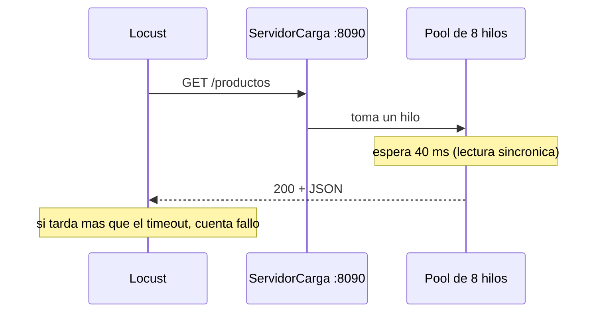

Trabajo Práctico N° 10 - Monitoreo, Pruebas de Carga y Evaluación de Desempeño

Materia: Desarrollo de Aplicaciones para Ambientes Distribuidos
Cátedra: Lic. Gabriel Artaza
Alumno: Suarez Gonzalo
Lenguaje: Java (JDK) para el servicio y Python para la carga
Herramientas: `HttpServer` del JDK y Locust 2.47.0
Servicio evaluado: `GET http://localhost:8090/productos` 


Entorno

| Dato | Valor |
| --- | --- |
| Procesador | Intel Core i3-10100 @ 3.60 GHz (4 núcleos, 8 hilos) |
| Memoria | 32 GB |
| Sistema | Windows 10 (build 19045) |
| Java | 24.0.1 |
| Python | 3.13.2 |
| Locust | 2.47.0 |

El endpoint es el mismo recurso de los prácticos anteriores (`/productos`), armado de nuevo en `TP10` para poder medirlo sin Docker, sin PostgreSQL y sin TLS. El JSON de la lista ya está armado en memoria. Cada `GET` igual retiene un hilo del servidor **40 ms**, que es el tiempo de una lectura sincrónica. El servidor tiene un pool fijo de **8 hilos**.


Arquitectura de la prueba



- Carga normal: 50 usuarios, cada uno espera entre 1 y 2 segundos, durante 2 minutos. Timeout del cliente: 5 s.
- Estrés de la corrida ya hecha: 30 segundos en 50 usuarios y después una rampa hasta 250, unos 3 minutos. Timeout del cliente: 0,5 s. Esa corrida ya terminó y el proceso se cerró.
- Si volvés a abrir Locust para las fotos, el `locustfile.py` ahora corta solo a los 90 segundos y no pasa de 80 usuarios. No lo dejes corriendo.


Cómo ejecutarlo

Desde `Ambiente-Distribuido`. Si Locust no está instalado: `pip install -r TP10\requirements.txt`.

Terminal 1, el servicio:

```
javac -encoding UTF-8 TP10\servidor\ServidorCarga.java
java TP10.servidor.ServidorCarga
```

Terminal 2, carga normal (2 minutos):

```
$env:TP10_MODO = "carga"
python -m locust -f TP10\locustfile.py --headless -u 50 -r 10 -t 120s --host http://localhost:8090 --csv TP10\resultados\carga --html TP10\resultados\carga.html
```

Terminal 2, estrés (la rampa la define `locustfile.py`):

```
$env:TP10_MODO = "estres"
python -m locust -f TP10\locustfile.py --headless -t 90s --host http://localhost:8090 --csv TP10\resultados\estres
```

`GET http://localhost:8090/metricas` devuelve los contadores del proceso (pedidos, latencia vista por el servidor).


Resultados de la corrida del 12 de noviembre de 2026

Carga normal, servicio recién iniciado, 50 usuarios, 120 segundos. Locust terminó con código 0.

| Métrica | Valor |
| --- | --- |
| Pedidos | 3815 |
| Fallos | 0 (0 %) |
| Throughput | 32 req/s |
| Mínimo | 40 ms |
| Mediana | 42 ms |
| Promedio | 42 ms |
| Percentil 95 | 45 ms |
| Máximo | 186 ms |
| CPU del proceso | pico 1,9 % de la máquina |
| RAM del proceso | 65 a 125 MB |

Estrés, rampa de 50 a 250 usuarios, unos 3 minutos. Los fallos son timeouts de lectura a los 0,5 s (el servidor no llegó a responder a tiempo).

| Usuarios | Req/s del intervalo | Fallos/s | Mediana | Percentil 95 |
| --- | --- | --- | --- | --- |
| 50 | 102 | 0 | 53 ms | 110 ms |
| 100 | 196 | 0 | 170 ms | 370 ms |
| 150 | 222 | 222 | 290 ms | 510 ms |
| 200 | 292 | 292 | 470 ms | 520 ms |
| 250 | 379 | 379 | 510 ms | 530 ms |

Totales del estrés: 48772 pedidos, 34755 fallos (**71 %**), promedio 442 ms, mínimo 41 ms, máximo 867 ms, mediana 510 ms, percentil 95 de 540 ms, 270 req/s contando los timeouts. Durante el pico la CPU del proceso no pasó de **1,7 %** de la máquina y la RAM subió hasta **823 MB** (conexiones encoladas).

El detalle está en `TP10/resultados/` (`carga_stats.csv`, `estres_stats.csv`, `estres_stats_history.csv`, `recursos-carga.csv`, `recursos-estres.csv` y `carga.html`).


Conclusión y cuello de botella

El límite no fue el procesador ni el disco. Con 8 hilos y 40 ms de espera sincrónica, el servicio puede completar alrededor de 8 / 0,040 = **200 pedidos por segundo**. Hasta unos 100 usuarios la latencia sube pero todavía no hay errores. Alrededor de **150 usuarios** la cola empuja la respuesta por encima de 0,5 s y Locust empieza a contar timeouts. A 250 usuarios casi todo el intervalo falla y la mediana se queda clavada cerca de ese timeout.

La mejora que corresponde es no ocupar un hilo durante la espera: ampliar el pool, atender la lectura de forma asincrónica, o sacar los 40 ms de encima con caché de la consulta (el JSON ya está en memoria; el costo medido es el bloqueo). Otra salida, la del TP8, es repartir las lecturas entre réplicas para que un solo pool deje de ser el tope.


Capturas que faltan sacar

El informe ya tiene los números de la corrida. Estas tres fotos van en `TP10\imagenes` para la entrega. El servidor tiene que estar arriba (`java TP10.servidor.ServidorCarga`).

1. **`locust-ejecucion.jpeg`** — Locust con usuarios virtuales en marcha. En otra terminal:

```
$env:TP10_MODO = "estres"
python -m locust -f TP10\locustfile.py --host http://localhost:8090
```

Abrí `http://localhost:8089` y dale a Start. La rampa se detiene sola a los 90 segundos y no pasa de 80 usuarios. Sacá la foto mientras el contador sube y, al terminar, cerrá esa terminal y la del servidor. No dejes ninguna de las dos abiertas.

2. **`locust-resumen.jpeg`** — la misma ventana, pestaña de gráficos o de estadísticas, con la mediana, el percentil y los fallos visibles al final de la rampa.

3. **`recursos.jpeg`** — el Administrador de tareas, pestaña Detalles, el proceso `java.exe` del servidor, con CPU y memoria durante ese pico.

Captura 1 — Locust en ejecución:


Captura 2 — resumen de métricas:


Captura 3 — CPU y RAM en el punto de quiebre:

