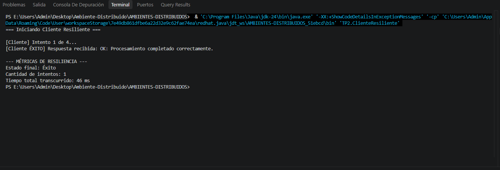
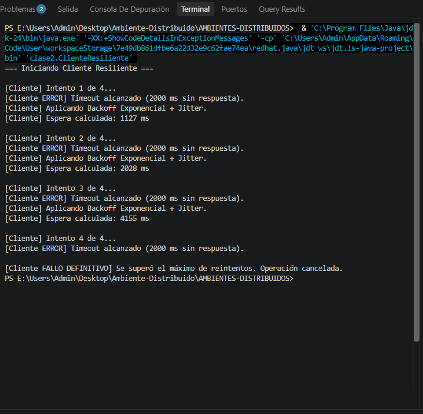
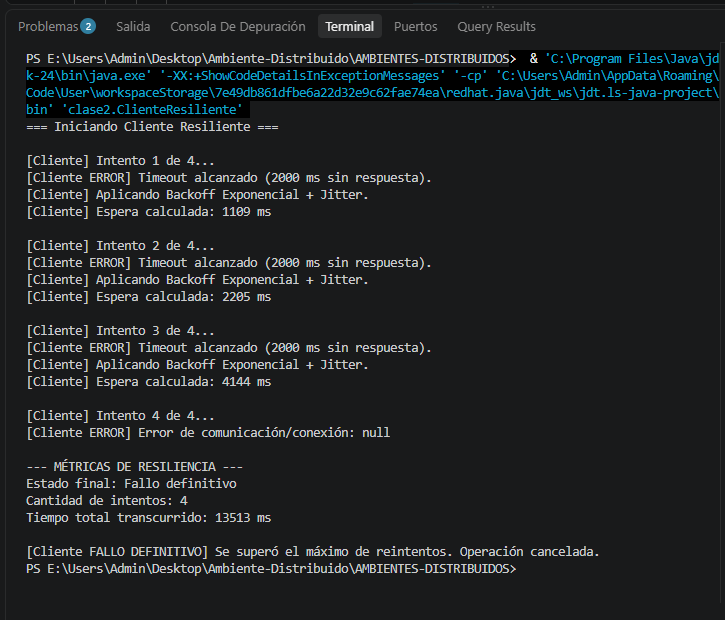

1. Problema de los reintentos simultáneos: Thundering Herd Problem

Cuando un servidor está saturado o presenta una falla temporal, es habitual que los clientes intenten nuevamente realizar las peticiones que fallaron. El problema aparece cuando muchos clientes realizan esos reintentos exactamente al mismo tiempo y utilizando intervalos fijos.

Por ejemplo, si 100 clientes reciben un error al mismo tiempo y todos tienen configurado un reintento después de 2 segundos, los 100 clientes volverán a enviar sus peticiones prácticamente en el mismo instante.

Esto genera un nuevo pico de tráfico sobre el servidor, que puede encontrarse todavía recuperándose de la falla. Como consecuencia, el servidor puede volver a saturarse, producir nuevos errores y provocar que los clientes vuelvan a reintentar. Se genera así un ciclo que puede empeorar progresivamente la situación y convertirse en una "tormenta de reintentos" (retry storm).

Este fenómeno se conoce como Thundering Herd Problem o Efecto Estampida, porque muchos clientes actúan de manera sincronizada como una multitud que se dirige simultáneamente hacia el mismo recurso.

Incluso utilizar Backoff Exponencial sin Jitter puede generar este problema, porque si todos los clientes comienzan a fallar aproximadamente al mismo tiempo, también pueden realizar sus siguientes reintentos en los mismos momentos.

La utilización de Jitter permite solucionar este problema agregando un componente aleatorio al tiempo de espera. De esta manera, los clientes dejan de estar sincronizados y los reintentos se distribuyen a lo largo de un período de tiempo.

Por ejemplo, dos clientes podrían tener un tiempo base de 2000 ms, pero uno podría reintentar después de 2135 ms y otro después de 2478 ms. Esto reduce la posibilidad de que todos los clientes generen una nueva ráfaga de solicitudes simultáneamente.

Por lo tanto, el Jitter ayuda a distribuir la carga y permite que el servidor tenga más posibilidades de recuperarse. AWS recomienda precisamente utilizar backoff exponencial, Jitter y un límite máximo de reintentos para evitar picos artificiales de tráfico.

2. Diferencia entre fallo transitorio y fallo permanente

Un fallo transitorio es un problema temporal que puede desaparecer por sí mismo después de un determinado período de tiempo. En estos casos, realizar nuevamente la operación después de una espera puede permitir que la petición tenga éxito.

Un ejemplo en una arquitectura distribuida sería una pérdida momentánea de conexión de red o un servidor que temporalmente no puede responder debido a una sobrecarga. Si el servicio se recupera unos segundos después, un nuevo intento puede completarse correctamente. Microsoft define este tipo de fallo como temporal y con posibilidades de resolverse mediante un reintento adecuado.

En cambio, un fallo permanente es aquel que no se solucionará simplemente esperando y realizando nuevamente la misma petición. El problema requiere una corrección, modificación de configuración o intervención externa.

Por ejemplo, si un cliente intenta acceder a un servicio utilizando credenciales incorrectas o solicita un recurso que no existe, realizar nuevos reintentos con las mismas condiciones no solucionará el problema. Otro ejemplo sería una configuración incorrecta de permisos que impide permanentemente el acceso al recurso hasta que se modifique dicha configuración. AWS señala que no se deberían reintentar indiscriminadamente errores cuya causa claramente requiere una intervención o corrección.

Capturas de Pantalla de la Ejecución

