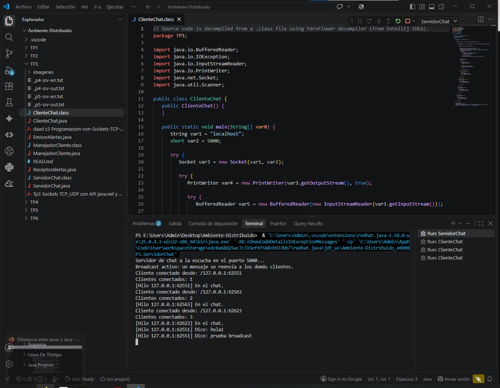
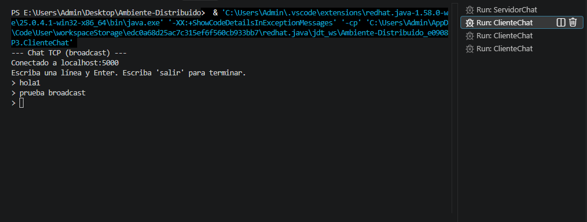
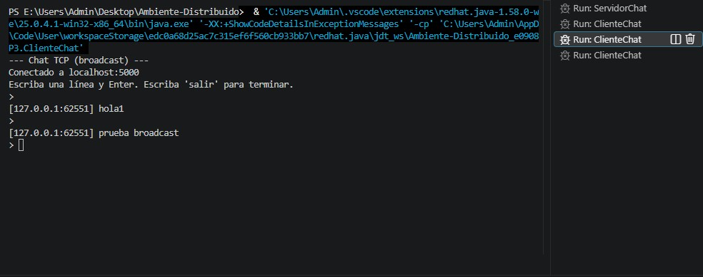
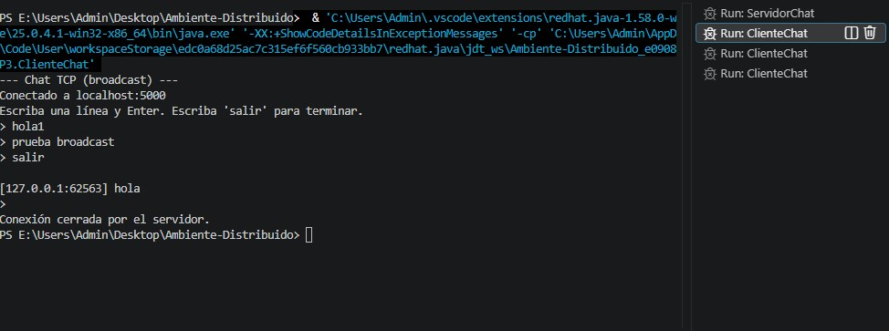
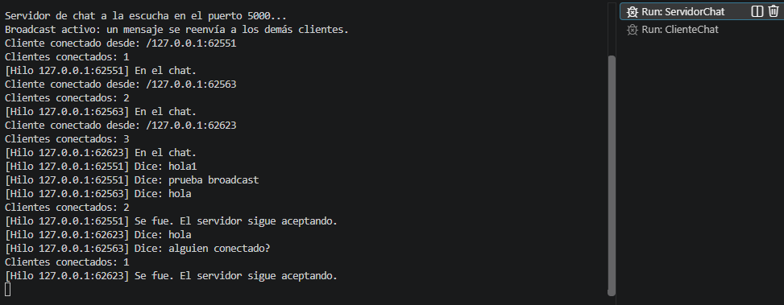
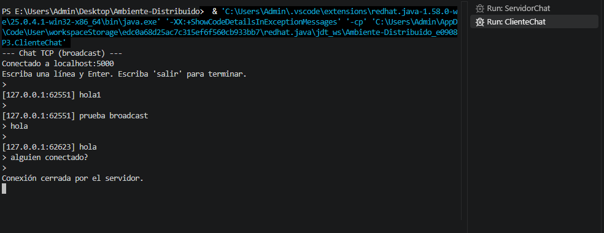
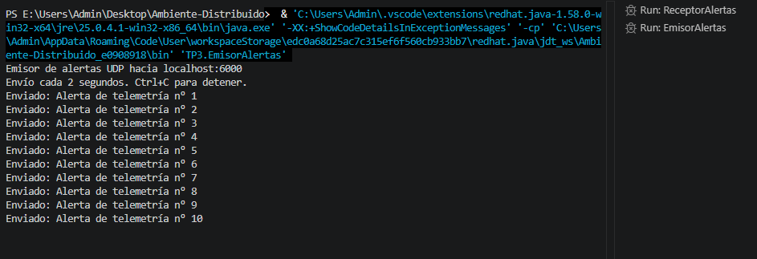
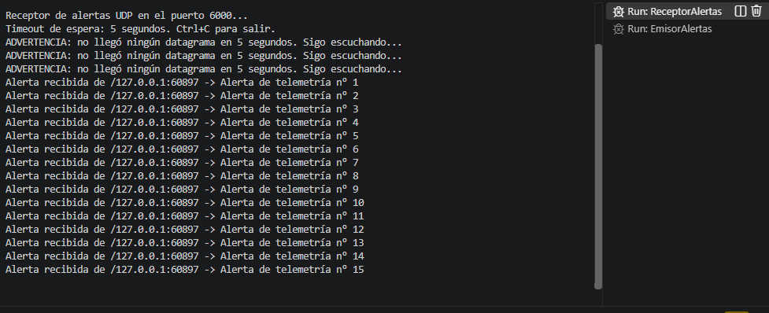

Trabajo Práctico N° 3 - Sockets TCP/UDP y Servidores Multihilo

Materia: Desarrollo de Aplicaciones para Ambientes Distribuidos
Tema: Sockets TCP/UDP con API java.net y Servidores Multihilo
Alumno: Suarez Gonzalo


1) Capa de Transporte: TCP vs UDP en el paso de mensajes

TCP es orientado a conexión: en el chat, `ClienteChat` abre un `Socket` a `localhost:5000` y `ServidorChat` entrega esa sesión con `accept()`. A partir de ahí hay un canal estable (flujo de bytes, líneas con `readLine`/`println`). Si un cliente se va, solo se cierra su socket; los demás siguen en la lista `CopyOnWriteArrayList`.

UDP no arma esa sesión. `EmisorAlertas` crea un `DatagramPacket` y lo manda a `localhost:6000` cada 2 segundos; `ReceptorAlertas` escucha con `DatagramSocket.receive`. Cada alerta es un datagrama suelto: no hay `accept()`, ni garantía de orden, ni retransmisión. Por eso el receptor no “sabe” si el emisor sigue vivo hasta que deja de llegar tráfico y vence el timeout.

En este TP, TCP sirve para un chat donde cada mensaje tiene que llegar a los otros clientes conectados. UDP sirve para telemetría periódica, donde un hueco de 5 segundos se trata como advertencia y se sigue escuchando.

2) API java.net: `ServerSocket.accept()` y un hilo por cliente

`accept()` bloquea al hilo que lo llama hasta que entra una conexión TCP y entonces devuelve el `Socket` de ese cliente. En `ServidorChat` el `while (true)` hace exactamente eso en el puerto 5000: aceptar, lanzar `new Thread(new ManejadorCliente(cliente))` y volver a `accept()`.

Si el mismo hilo que acepta se quedara leyendo líneas de un cliente (como en el paso 3, el eco), no podría atender a un segundo `Socket`. Con un `Runnable` por cliente, `ManejadorCliente` lee, llama a `ServidorChat.difundir` y, al desconectar, se saca de la lista y cierra solo su socket. El servidor no se apaga: en las pruebas, al salir un cliente el log muestra “Se fue. El servidor sigue aceptando” y el contador de conectados baja, pero el resto sigue chateando.

3) Pérdida UDP y `setSoTimeout(5000)`

Si el datagrama del emisor se pierde (o el emisor se detiene con Ctrl+C), UDP no avisa ni reintenta: el paquete simplemente no aparece en el receptor. `ReceptorAlertas` configura `socket.setSoTimeout(5000)` para que `receive` no se quede bloqueado para siempre. A los 5 segundos sin datos lanza `SocketTimeoutException`; el `catch` imprime “ADVERTENCIA: no llegó ningún datagrama en 5 segundos. Sigo escuchando...” y el `while (true)` vuelve a esperar. No se sale del programa: si el emisor vuelve a mandar, las alertas se imprimen de nuevo.

===========================================================================

Este proyecto usa la API `java.net` en dos ejercicios. El chat TCP (`ServidorChat`, `ManejadorCliente`, `ClienteChat`) es un servidor concurrente en el puerto 5000: cada conexión tiene un hilo y los mensajes se reenvían a los demás clientes. Las alertas UDP (`EmisorAlertas`, `ReceptorAlertas`) mandan datagramas al puerto 6000; el receptor espera con timeout de 5 segundos.

Hay que ejecutar siempre primero quien escucha (servidor TCP o receptor UDP) y después los clientes o el emisor.

1. Compilación

```
javac TP3\ServidorChat.java TP3\ClienteChat.java TP3\ManejadorCliente.java TP3\ReceptorAlertas.java TP3\EmisorAlertas.java
```

2. Ejecutar el chat TCP

Primero el servidor:

```
java TP3.ServidorChat
```

Después, en tres terminales distintas, un cliente en cada una:

```
java TP3.ClienteChat
```

Escribir una línea en un cliente: los otros dos deben ver `[ip:puerto] texto`. Con `salir` solo se cierra ese cliente; el servidor y el resto siguen.

3. Ejecutar las alertas UDP

Primero el receptor:

```
java TP3.ReceptorAlertas
```

Después el emisor:

```
java TP3.EmisorAlertas
```

El receptor muestra las alertas cada ~2 segundos. Detener el emisor con Ctrl+C y esperar 5 segundos para ver la advertencia de timeout; el receptor no termina.

Capturas de Pantalla de la Ejecución

Chat TCP (servidor y tres clientes, broadcast):




Desconexión (un cliente se va; el servidor y los otros siguen):




Alertas UDP:


 