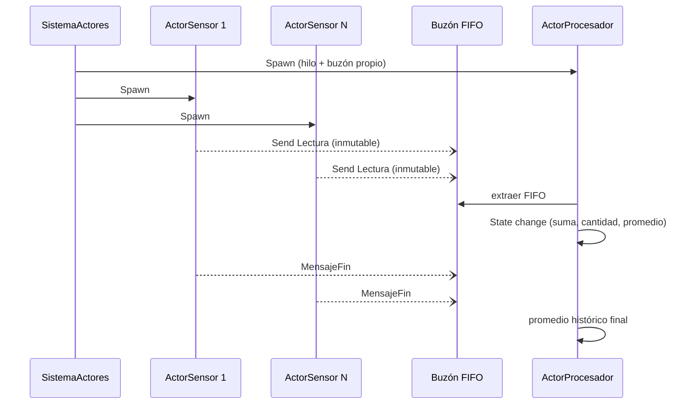
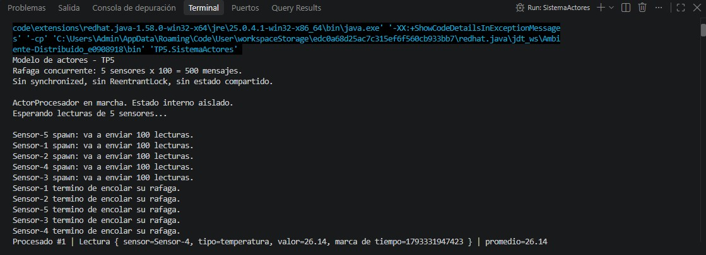
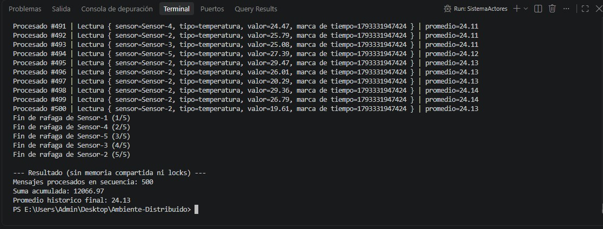

Trabajo Práctico N° 5 - Concurrencia y Sincronización con el Modelo de Actores

Materia: Desarrollo de Aplicaciones para Ambientes Distribuidos
Tema: Modelo de actores, buzón FIFO y paso de mensajes asincrónicos
Alumno: Suarez Gonzalo


Objetivo

Comprender e implementar el Modelo de Actores para concurrencia sin memoria compartida ni bloqueos (`synchronized` / `ReentrantLock`). Los sensores mandan lecturas inmutables al buzón del procesador; ese actor las atiende de a una (FIFO) y guarda el contador y el promedio histórico solo en su estado privado.


Arquitectura de actores

- `ActorSensor`: dispositivo. Genera lecturas de temperatura (mensaje inmutable `Lectura`) y las envía al buzón del procesador. Al terminar su ráfaga manda un `MensajeFin`.
- `ActorProcesador`: nodo central. Un solo hilo extrae del `Buzon` en orden FIFO, actualiza cantidad / suma / promedio y no expone setters del estado.
- `Buzon`: cola FIFO (`ConcurrentLinkedQueue`). El `offer` es el Send asíncrono; el procesador hace `poll` + espera con `LockSupport` (sin monitors ni locks de la consigna).


Las tres operaciones

1. Crear (Spawn): `SistemaActores` instancia el procesador y cinco sensores, cada uno con su hilo.
2. Enviar (Send): cinco sensores en paralelo encolan 100 lecturas cada uno (500 mensajes) hacia el mismo buzón.
3. Designar (State Change): por cada `Lectura`, el procesador incrementa `cantidad`, suma el valor y recalcula `promedio` antes de pasar al siguiente mensaje.


Por qué no hay condición de carrera

Varios hilos escriben en el buzón, pero solo el hilo del `ActorProcesador` lee y muta `cantidad`, `suma` y `promedio`. El estado no se comparte: se comunica con objetos de mensaje.


Diagrama de secuencia (paso de mensajes)




===========================================================================

1. Compilación

```
java TP5\SistemaActores.java
```

2. Ejecución

```
java TP5.SistemaActores
```

En consola se ve el spawn de los sensores, las 500 lecturas procesadas en secuencia (`Procesado #1` … `Procesado  #500`) y el promedio histórico final. El orden de llegada de sensores puede intercalarse; el procesamiento dentro del actor es siempre de a un mensaje.

Capturas de Pantalla de la Ejecución

Spawn y comienzo del procesamiento secuencial:


Cierre de ráfaga y promedio final (500 mensajes, sin locks):

