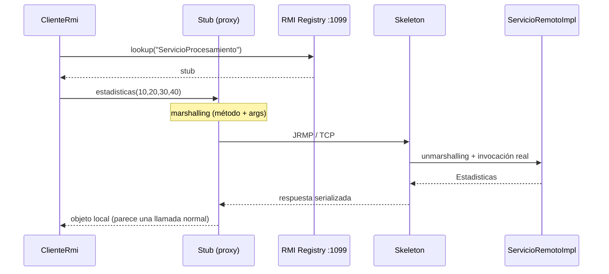
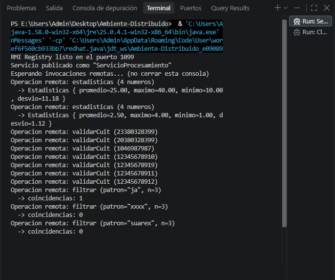
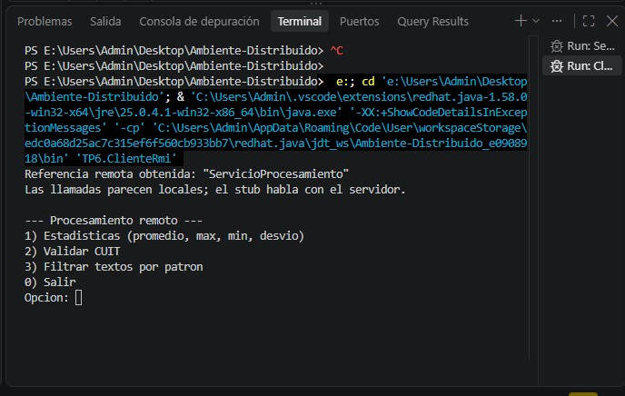

Trabajo Práctico N° 6 - Middleware y Objetos Remotos (RMI)

Materia: Desarrollo de Aplicaciones para Ambientes Distribuidos
Tema: Invocación remota de métodos, stub/skeleton y registro de nombres
Alumno: Suarez Gonzalo


Objetivo

Implementar un servicio de procesamiento remoto con Java RMI: el cliente llama métodos como si fueran locales y el middleware oculta sockets, marshalling y el protocolo de petición/respuesta. Tres operaciones: estadísticas sobre un arreglo, validación de CUIT y filtro de textos por patrón.


Arquitectura

- `ServicioRemoto`: interfaz `extends Remote`. Contrato (estadisticas, validarCuit, filtrar) con `RemoteException` en cada método.
- `Estadisticas`: DTO `Serializable` (promedio, máximo, mínimo, desvío). RMI lo copia al cliente por valor.
- `ServicioRemotoImpl`: lógica en el servidor. Extiende `UnicastRemoteObject` e implementa la interfaz. Imprime traza de cada operación.
- `ServidorRmi`: crea el RMI Registry en el puerto 1099 y hace `rebind("ServicioProcesamiento", ...)`.
- `ClienteRmi`: `lookup` + menú por consola. No usa `Socket` ni serializa a mano.


Diagrama de secuencia (ida / servidor / vuelta)




===========================================================================

Hay que ejecutar siempre primero el servidor y después el cliente, desde la carpeta `Ambiente-Distribuido`.

1. Compilación

```
javac TP6\Estadisticas.java TP6\ServicioRemoto.java TP6\ServicioRemotoImpl.java TP6\ServidorRmi.java TP6\ClienteRmi.java
```

2. Servidor (terminal 1)

```
java TP6.ServidorRmi
```

Debe mostrar el registry en 1099 y el servicio publicado. No cerrar esa consola.

3. Cliente (terminal 2)

```
java TP6.ClienteRmi
```

Menú: `1` estadísticas (ej. `10 20 30 40`), `2` CUIT (ej. `20-12345678-6`), `3` filtro (cargar N cadenas y un patrón), `0` salir. En la terminal del servidor aparece `Operacion remota: ...` por cada llamada.

Si el servidor no está en marcha, el cliente informa que no pudo contactar el registry (mismo criterio que el "connection refused" del TP1).

Capturas de Pantalla de la Ejecución

Servidor publicado y trazas de las tres operaciones:


Cliente: menú y resultados transparentes:



Ejercicio 2 — Cuestionario

1) Abstracción del middleware (sockets puros vs RMI)

En TP4 el cliente abría un `Socket`, empaquetaba JSON o binario (`ParserMensajes`) y el servidor desempaquetaba a mano. Acá `ClienteRmi` no ve bytes ni puerto de aplicación: hace `lookup` y después `servicio.estadisticas(valores)`.

El middleware abstrae: (a) el transporte TCP y el protocolo JRMP; (b) marshalling/unmarshalling de argumentos y del `Estadisticas` de vuelta; (c) la localización del objeto vía registry (nombre `"ServicioProcesamiento"` en 1099, no una IP+puerto de socket de negocio); (d) el despacho del método correcto en el servidor. La lógica de negocio queda solo en `ServicioRemotoImpl`.

2) Ciclo de vida Stub / Skeleton

El Stub (proxy) vive en el cliente. `lookup` devuelve un objeto que implementa `ServicioRemoto` pero no calcula nada: serializa el nombre del método y los parámetros, los manda por red y bloquea al hilo (call-return de la clase) hasta la respuesta.

El Skeleton (dispatcher) vive en el servidor. Recibe esos bytes, reconstruye los argumentos, localiza el sirviente `ServicioRemotoImpl` y ejecuta el método real sobre la JVM del servidor. Empaqueta el resultado (o la excepción) y lo devuelve. El stub deserializa y se lo entrega al `main` del cliente como un return normal.

3) Fallos parciales

Si el servidor se interrumpe durante un método, el cliente no se “cuelga para siempre” de forma silenciosa: la llamada declara `RemoteException`. En esta práctica el menú la captura y muestra que el servidor se cayó o no respondió; el cliente sigue en el menú. Si el registry nunca llegó a estar, falla el `getRegistry`/`lookup` antes de cualquier operación.

En un entorno productivo no alcanza con imprimir el error: hay que distinguir timeout vs servidor caído vs argumento inválido (`IllegalArgumentException` del lado servidor viaja anidada), no asumir que la operación se completó (la red puede cortar después de ejecutar y antes de la respuesta), y reintentar solo si el método es idempotente. También conviene logs y, si aplica, degradar el servicio (avisar al usuario y no reintentar en loop infinito).
