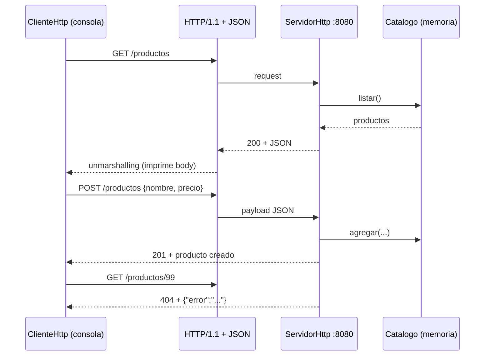
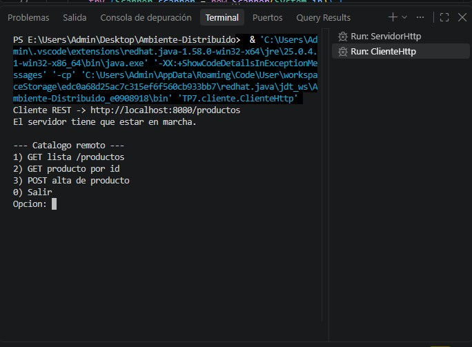
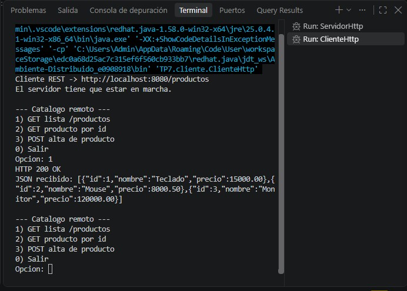
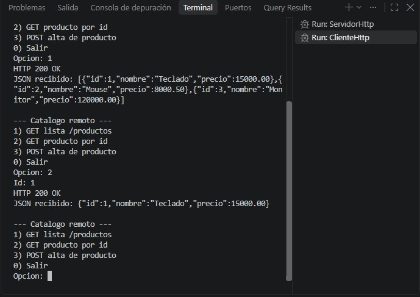
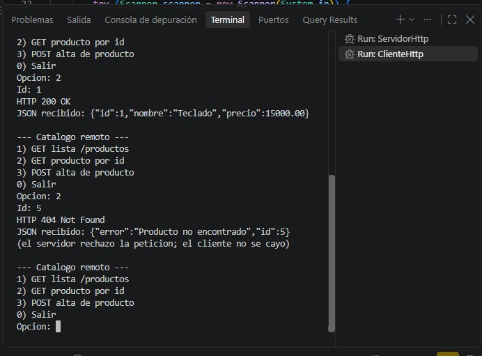
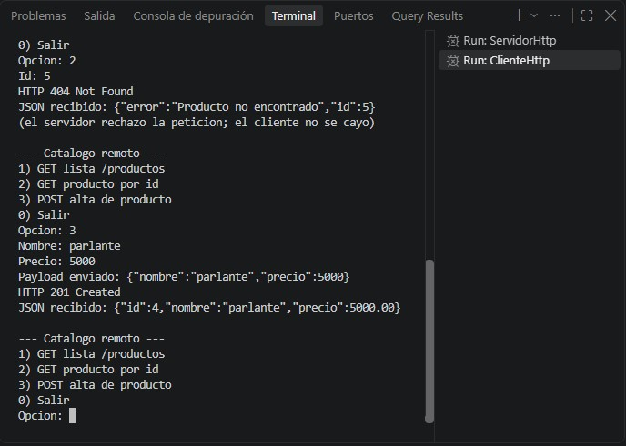

Trabajo Práctico N° 7 - Integración entre Capas y Consumo de APIs / Servicios Distribuidos

Materia: Desarrollo de Aplicaciones para Ambientes Distribuidos
Cátedra: Lic. Gabriel Artaza
Alumno: Suarez Gonzalo
Lenguaje: Java (JDK)
Frameworks: ninguno — `HttpServer` (servidor) y `java.net.http.HttpClient` (cliente)
Comunicación: REST sobre HTTP/1.1 + JSON


Objetivo

Exponer un catálogo de productos como API REST (GET lista, GET por id, POST alta) y consumirlo desde un cliente en **otro proceso**. El middleware HTTP reemplaza el socket a mano (TP4) y el stub RMI (TP6): el contrato son URI + verbo + JSON. Errores con códigos 400, 404 y 500.


Arquitectura

- `TP7/servidor`: `ServidorHttp` en el puerto 8080, `Catalogo` en memoria, `Producto` con marshalling JSON.
- `TP7/cliente`: `ClienteHttp`, menú por consola, independiente (no importa clases del servidor).
- Canal: HTTP/1.1, `Content-Type: application/json`. Cada petición es autónoma (stateless).


Diagrama de arquitectura




===========================================================================

Hay que ejecutar siempre primero el servidor y después el cliente, desde la carpeta `Ambiente-Distribuido`.

1. Compilación

```
javac TP7\servidor\Producto.java TP7\servidor\Catalogo.java TP7\servidor\ServidorHttp.java
javac TP7\cliente\ClienteHttp.java
```

2. Servidor (terminal 1)

```
java TP7.servidor.ServidorHttp
```

Escucha `http://localhost:8080/productos`. No cerrar esa consola. Se puede comprobar el GET en el navegador.

3. Cliente (terminal 2)

```
java TP7.cliente.ClienteHttp
```

Menú: `1` lista, `2` por id, `3` alta, `0` salir.

Pruebas sugeridas: opción 1 (200); opción 3 con nombre `Webcam` y precio `25000` (201); opción 2 con id `99` (404); opción 3 con precio `-1` (400). Si el servidor no está, el cliente informa que no pudo conectar.

Capturas de Pantalla de la Ejecución

Captura 1 — invocación exitosa (cliente y/o servidor):



Captura 2 — estructura de datos (JSON enviado o recibido):



Captura 3 — manejo de errores (404 o 400):

