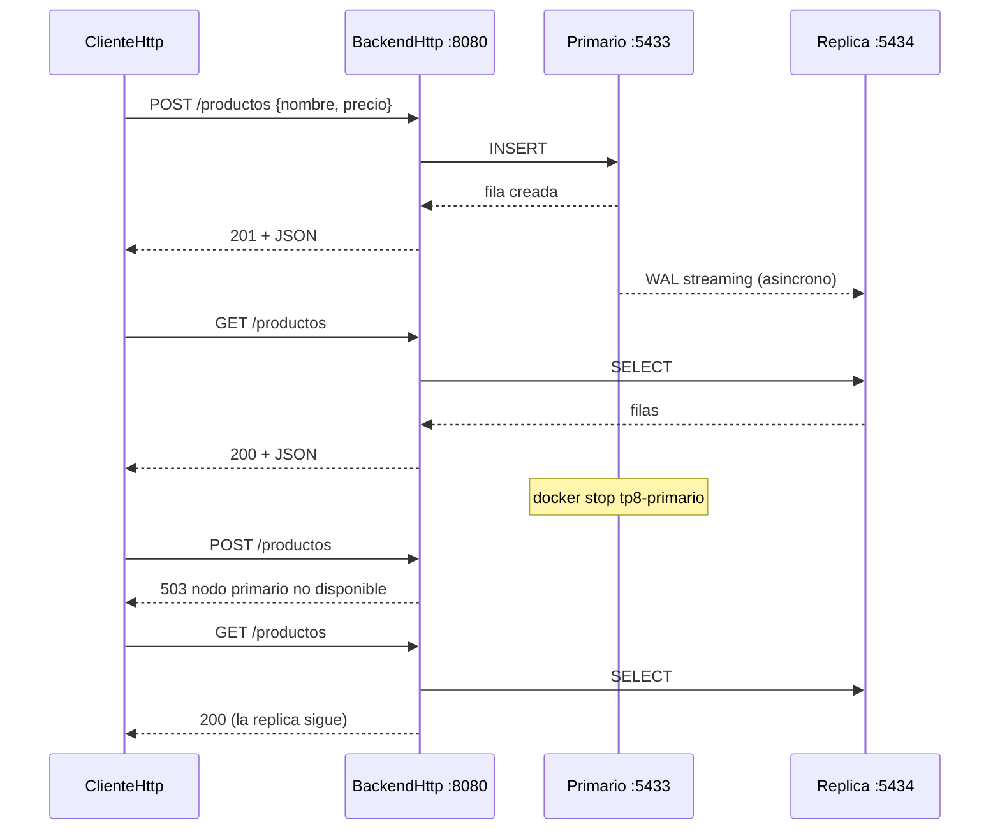
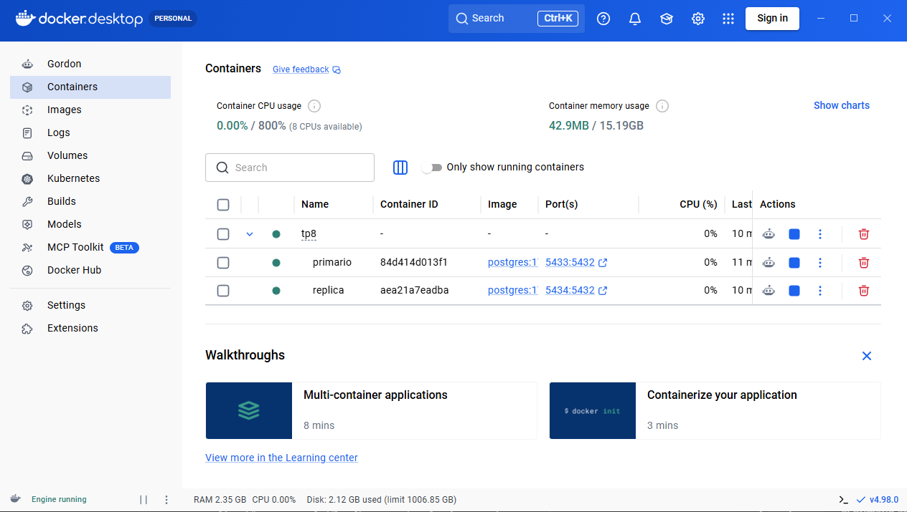
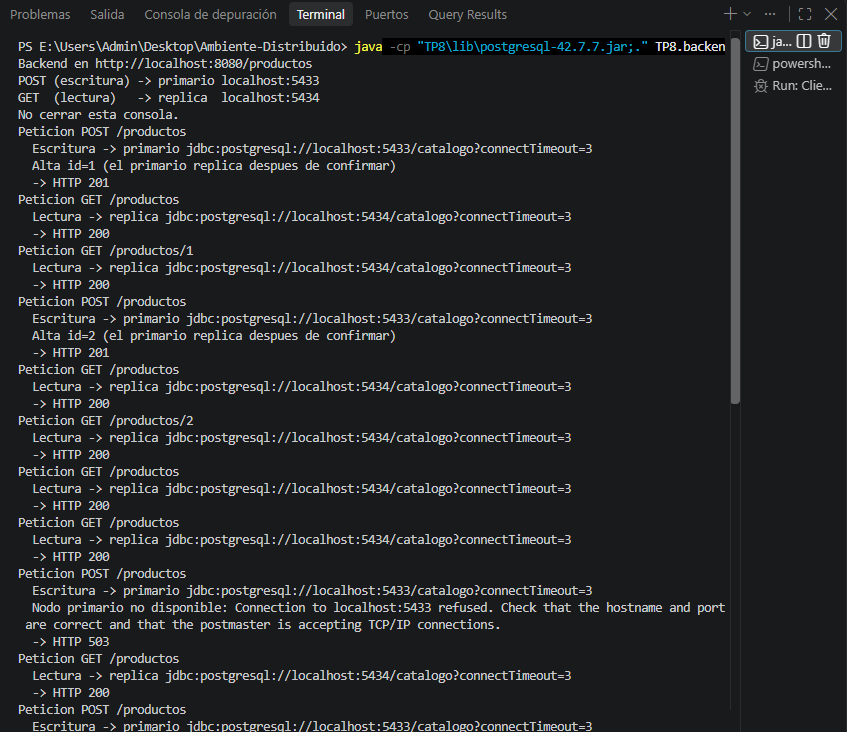
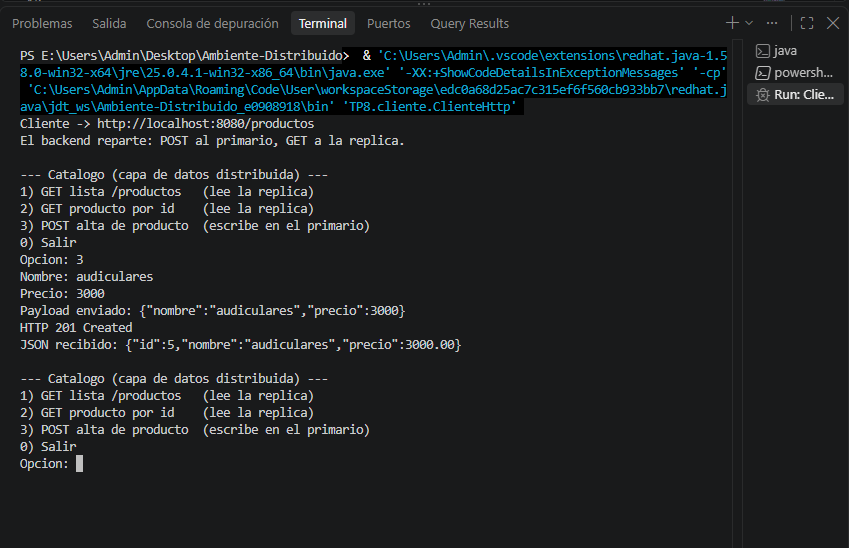
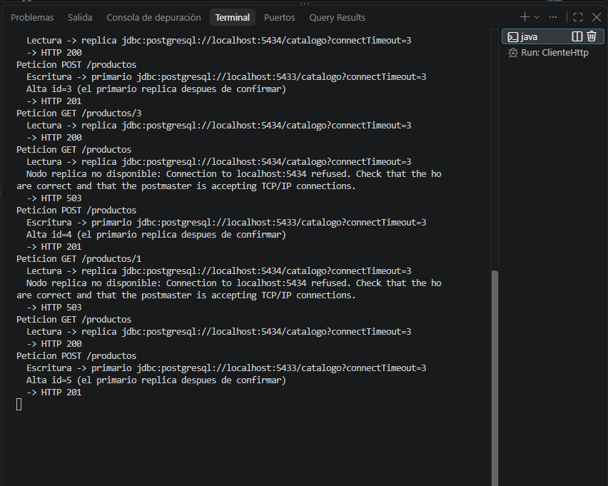
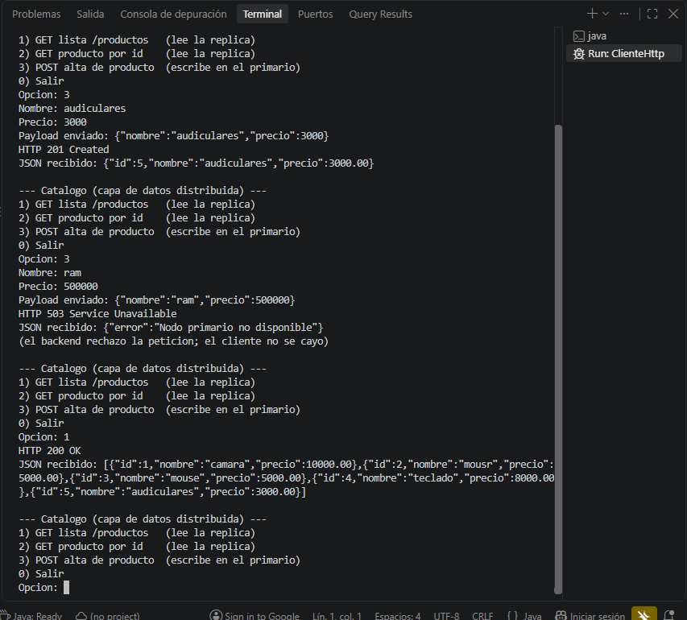

Trabajo Práctico N° 8 - Bases de Datos Distribuidas y Conexión entre Capas

Materia: Desarrollo de Aplicaciones para Ambientes Distribuidos
Cátedra: Lic. Gabriel Artaza
Alumno: Suarez Gonzalo
Lenguaje: Java (JDK) + PostgreSQL 17
Frameworks: ninguno — `HttpServer` (backend), `java.net.http.HttpClient` (cliente) y JDBC (`postgresql-42.7.7.jar`)
Infraestructura: Docker Compose, copia primaria con réplica de solo lectura


Objetivo

Persistir el catálogo de productos del TP7 en una base distribuida. El backend sigue siendo HTTP/JSON y stateless; el estado vive en PostgreSQL. Las escrituras van al nodo primario y las lecturas a la réplica. La propagación es asíncrona (el primario confirma y después copia el WAL). Si el primario cae, el POST responde 503 y el GET sigue leyendo la réplica.


Arquitectura

- `TP8/docker-compose.yml`: dos contenedores de `postgres:17` en la red `tp8`.
- `tp8-primario` (puerto 5433): único que acepta `INSERT`. Usuario de replicación `replicator`. Publica el WAL (`wal_level=replica`).
- `tp8-replica` (puerto 5434): se arma con `pg_basebackup` y queda en hot standby. Rechaza escrituras. Recibe el WAL en streaming.
- `TP8/backend`: `BackendHttp` en el puerto 8080. `CapaDatos` abre el JDBC del primario para el POST y el de la réplica para el GET.
- `TP8/cliente`: `ClienteHttp`, otro proceso. No importa clases del backend ni abre sockets a PostgreSQL.
- Base `catalogo`, usuario `app`, clave `app`. Tabla `producto` (`id`, `nombre`, `precio`).

El PostgreSQL instalado en Windows (puerto 5432) no forma parte de este clúster.


Diagrama de arquitectura




===========================================================================

Hay que tener Docker en marcha. Desde `TP8`, el clúster:

```
docker compose up -d
```

`docker compose ps` tiene que mostrar `tp8-primario` (5433) y `tp8-replica` (5434). Para bajarlos: `docker compose down`. Para apagar solo el maestro en la prueba de caída: `docker stop tp8-primario` y después `docker start tp8-primario`.

El backend y el cliente se ejecutan desde la carpeta `Ambiente-Distribuido`. El classpath del backend tiene que incluir el driver JDBC. El botón Run del editor no lo agrega y las dos bases aparecen como caídas.

1. Compilación

```
javac -encoding UTF-8 -cp "TP8\lib\postgresql-42.7.7.jar" TP8\backend\Producto.java TP8\backend\CapaDatos.java TP8\backend\BackendHttp.java TP8\cliente\ClienteHttp.java
```

2. Backend (terminal 1)

```
java -cp "TP8\lib\postgresql-42.7.7.jar;." TP8.backend.BackendHttp
```

Escucha `http://localhost:8080/productos`. En esa consola cada pedido dice si fue al primario o a la réplica. No cerrarla.

3. Cliente (terminal 2)

```
java TP8.cliente.ClienteHttp
```

Menú: `1` lista (réplica), `2` por id (réplica), `3` alta (primario), `0` salir.

Pruebas: opción `3` con nombre `camara` y precio `10000` (201, y el backend imprime `Escritura -> primario`); opción `1` (200, `Lectura -> replica`); opción `3` con precio `-1` (400). Con el primario detenido, la opción `3` responde 503 y la opción `1` sigue en 200.


Capturas de Pantalla de la Ejecución

Captura 1 — clúster en ejecución (primario y réplica):



Captura 2 — escritura en el primario y lectura en la réplica:



Captura 3 — caída del nodo primario (POST 503, GET 200 desde la réplica):

