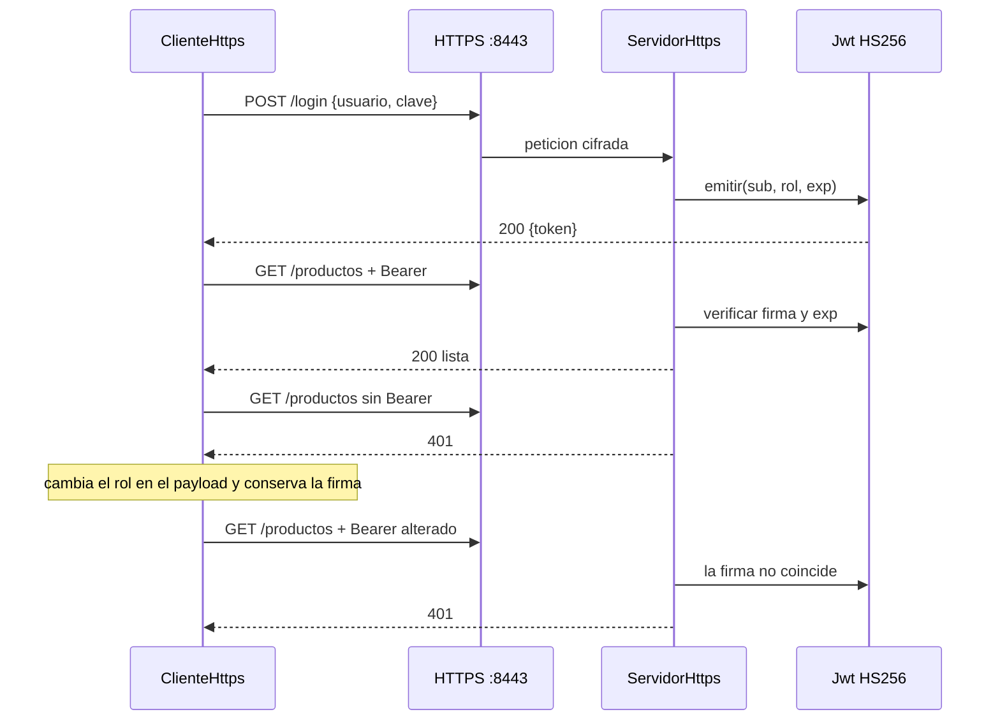
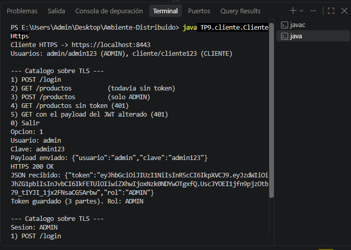
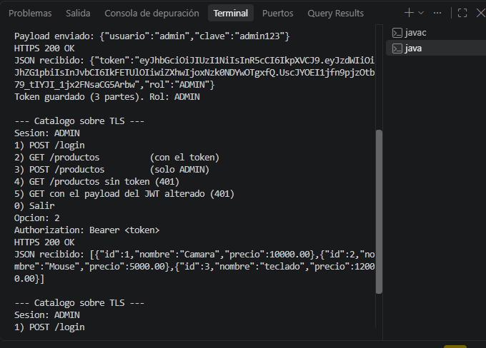
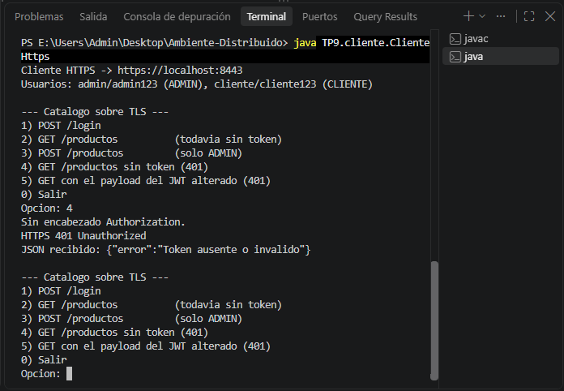
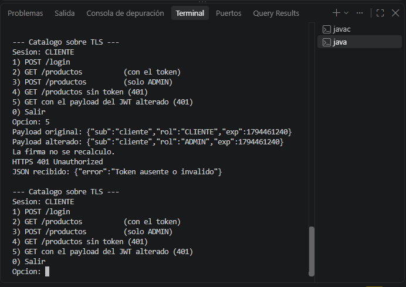

Trabajo Práctico N° 9 - Seguridad en Aplicaciones Distribuidas (JWT y TLS/SSL)

Materia: Desarrollo de Aplicaciones para Ambientes Distribuidos
Cátedra: Lic. Gabriel Artaza
Alumno: Suarez Gonzalo
Lenguaje: Java (JDK)
Frameworks: ninguno — `HttpsServer` (servidor), `java.net.http.HttpClient` (cliente), `javax.crypto.Mac` (JWT HS256) y `keytool` (certificado)
Canal: solo HTTPS. El catálogo de este práctico está en memoria y no usa el código ni la base del TP8.


Objetivo

Cerrar el canal y la identidad del catálogo. El servidor escucha únicamente por TLS con un certificado autofirmado de `localhost`. El login devuelve un JWT firmado (HMAC-SHA256) con `sub`, `rol` y `exp`. Las rutas de productos exigen `Authorization: Bearer`. Sin token, token inválido o vencido: 401. Rol que no alcanza: 403. Si se cambia el payload y se deja la firma vieja, el servidor rechaza el pedido.


Arquitectura

- `TP9/cert/servidor.p12`: almacén PKCS12, alias `tp9`, CN=`localhost`, clave `tp9tp9`. `servidor.cer` es el certificado público que confía el cliente.
- `TP9/servidor`: `ServidorHttps` en `https://localhost:8443`. `Usuarios` guarda el SHA-256 de las claves. `Jwt` emite y verifica la firma. `Catalogo` está en memoria.
- `TP9/cliente`: `ClienteHttps`, otro proceso. Arma el `SSLContext` solo con `servidor.cer`. No desactiva la verificación del certificado.
- Usuarios de prueba: `admin` / `admin123` (rol `ADMIN`) y `cliente` / `cliente123` (rol `CLIENTE`).
- `GET /productos`: cualquier rol autenticado. `POST /productos`: solo `ADMIN`. El cliente, si el rol no es `ADMIN`, no pide nombre ni precio.


Diagrama de arquitectura




===========================================================================

El certificado ya está generado. Si hay que rehacerlo, con el `keytool` del JDK:

```
keytool -genkeypair -alias tp9 -keyalg RSA -keysize 2048 -storetype PKCS12 -keystore TP9\cert\servidor.p12 -storepass tp9tp9 -keypass tp9tp9 -dname "CN=localhost, OU=TP9, O=DAAD, L=Salta, ST=Salta, C=AR" -validity 365 -ext SAN=dns:localhost,ip:127.0.0.1
keytool -exportcert -alias tp9 -keystore TP9\cert\servidor.p12 -storepass tp9tp9 -rfc -file TP9\cert\servidor.cer
```

Hay que ejecutar siempre primero el servidor y después el cliente, desde la carpeta `Ambiente-Distribuido`.

1. Compilación

```
javac -encoding UTF-8 TP9\servidor\Jwt.java TP9\servidor\Usuarios.java TP9\servidor\Producto.java TP9\servidor\Catalogo.java TP9\servidor\ServidorHttps.java TP9\cliente\ClienteHttps.java
```

2. Servidor (terminal 1)

```
java TP9.servidor.ServidorHttps
```

Escucha `https://localhost:8443`. No hay puerto HTTP en claro. No cerrar esa consola. Cada pedido imprime que llegó por TLS y, si hay token, el `sub` y el `rol`.

3. Cliente (terminal 2)

```
java TP9.cliente.ClienteHttps
```

Menú: `1` login, `2` lista con el token, `3` alta (solo si el rol es `ADMIN`), `4` lista sin token, `5` payload alterado, `0` salir.

Pruebas: opción `1` con `admin` / `admin123` (200 y el token); opción `2` (200); opción `4` (401); opción `5` (401, la firma no se recalculó). Con `cliente` / `cliente123`, la opción `3` avisa que el rol no puede dar de alta y no pide los datos. La vigencia del token es de una hora.


Capturas de Pantalla de la Ejecución

Captura 1 — emisión del JWT (`POST /login`):


Captura 2 — acceso autorizado por HTTPS (Bearer y HTTP 200):


Captura 3 — rechazo sin token (HTTP 401):


Captura 4 — tampering: payload alterado y firma vieja (HTTP 401):

